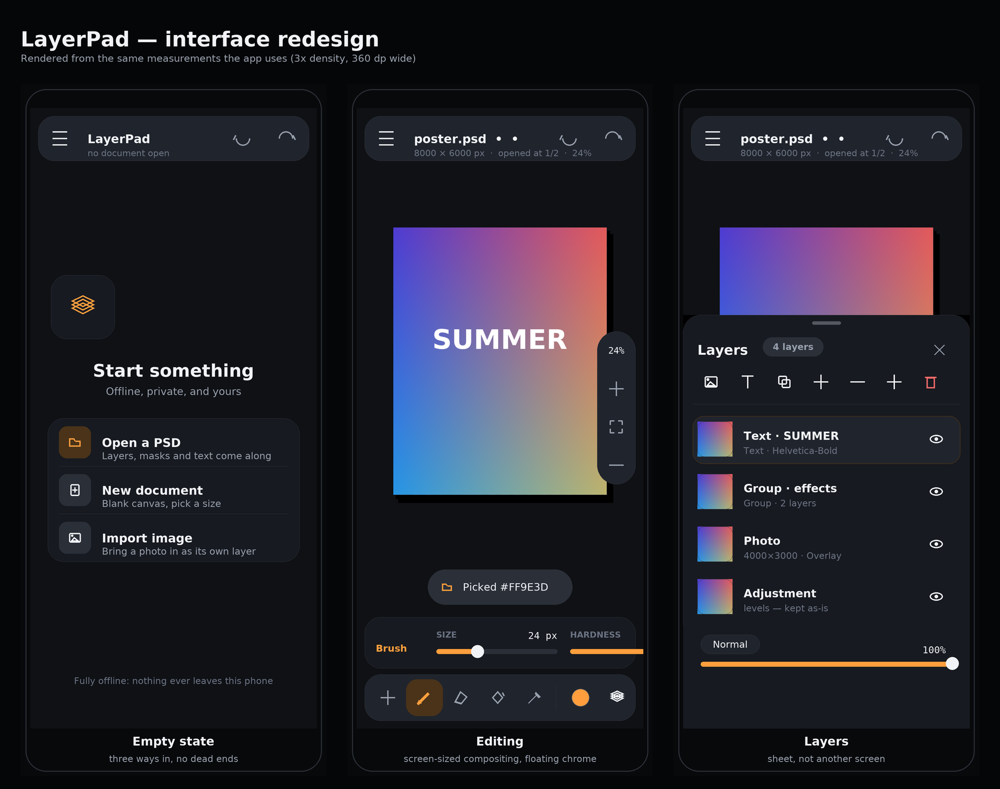

# LayerPad

**An offline PSD editor for Android.** Open a `.psd` from your phone, move layers,
paint, retype the text, and save a real layered PSD back — on a small screen,
with no account, no upload and no AI.

The app requests **no permissions at all**: files go in and out through the system
file picker, so it cannot reach the network or your photo library on its own.
There is no cloud, no telemetry, no analytics and no AI feature to disable.

```
gradle :app:assembleDebug        # side-loadable debug APK
gradle :app:assembleRelease      # R8-shrunk release APK, signed when the env vars are set
tools/engine-test.sh             # whole engine test suite, on a desktop JVM
```

You do not need Android Studio, and you do not need to build it yourself: every
push builds both APKs in CI — open the latest run of the **Android APK** job and
download the `photocc-apk` artifact, then install it on the phone (the debug APK
installs as-is; the release APK needs the four signing environment variables
below, or CI leaves it unsigned).

---

## Why it exists

Desktop PSD editors need a workstation or a subscription, and the small Android
alternatives tend to lag behind new Android releases. LayerPad is the boring
offline tool: it opens the layered files you already have and gives you the few
edits you actually make on a phone, using framework APIs only so it keeps working
on whatever Android version the phone shipped with.

It is deliberately **not** a Photoshop clone, and it does not pretend to be: what
it cannot draw, it preserves.

## What it does

| Area | Support |
| --- | --- |
| Open | `.psd` / `.psb`, RGB · Grayscale · Indexed, 8-bit (16-bit is down-shifted and reported honestly; CMYK/Lab/Duotone are opened read-only-ish and flagged) |
| Layers | Raster, **groups**, text layers, visibility, per-layer opacity, ~26 blend modes, layer masks (preserved, used when drawing) |
| Paint | Brush with size / hardness / flow, eraser, bucket fill with tolerance, one undo step per stroke |
| Text | Create, retype, restyle: font, size, alignment, tracking, leading, bold/italic, colour — and the layer stays **editable in Photoshop** |
| Move | Drag a layer with one finger; two fingers always pan/zoom; double-tap to fit |
| Save | Layered PSD with a merged preview, text layers left editable, plus flattened PNG / JPEG export at any scale |
| History | Byte-budgeted undo/redo: pixel edits store only the 128 px cells they touched, structural edits clone the tree but share pixel buffers |
| Big files | Documents over a 24 MPix import budget open **sampled down** (1/2, 1/3, 1/4) instead of failing; the UI says so, and the merge/save paths stream in bands |

Anything the engine does not model — adjustment layers, layer styles, vector
paths, smart objects, colour profiles, metadata, thumbnails — is **kept in the
file and written back untouched**. Opening and saving a file this project did not
create will not silently destroy it.

## Touch-first by design

The phone is held in one hand, so:

- **one finger** does whatever the active tool does; **two fingers** always pan and zoom — no modal hand tool, no accidental strokes while pinching;
- the tool dock and the layer sheet live at the **bottom edge**, inside thumb reach; the layer sheet slides up over the canvas;
- the document identity (name, size, and a warning when the file had to be sampled down) sits in a floating pill at the top, with undo/redo; zoom in / fit / zoom out float on the right edge;
- the options strip above the dock only shows the controls the active tool actually uses;
- every control is at least 48 dp tall, and the app is built with framework widgets only (no Compose, no AndroidX), so it starts in tens of milliseconds and looks native on every OEM skin.



The picture is rendered from the same measurements the app uses — see
`docs/render-ui-preview.py`, which is how the design can be reviewed without
building the APK.

## Not dying on a phone

The first versions of the app died on real files: a 12 MPix document meant a
48 MB `IntArray` plus a 48 MB bitmap on **every redraw**, a 50 MPix camera JPEG
was decoded at full size, and saving allocated four document-sized channel planes.
All three are fixed by never holding a document-sized buffer:

- the canvas composites the document **band by band straight into a screen-sized
  buffer** (`Render.flattenScaled`), with a 96 MB cap, a half-resolution retry and
  a message rather than a crash;
- PSD import has a **24 MPix budget** and samples larger files down, scaling layer,
  mask and text geometry with them;
- the merged image written on save is band-wise, and documents past 6 MPix are
  streamed **channel by channel** into the output; the RLE row tables are
  back-patched in place instead of copying the buffer per row;
- export composites into an export-sized bitmap, never a document-sized one.

`tools/engine-test.sh` checks all of it on a desktop JVM, including a
"large documents and the memory budget" section, so a regression fails the build
instead of someone's phone.

## Architecture

```
app/src/main/java/com/photocc/app/
  core/       PSD engine — plain Kotlin/JVM, zero android.* imports
    PsdRead.kt     decoder: header, image resources, layer records, channels
    PsdWrite.kt    encoder: RGB/8-bit PSD + PSB, RLE, merged preview
    ChannelCodec.kt  Raw / RLE / ZIP / ZIP+prediction codecs
    Descriptors.kt   Photoshop descriptors + the TySh text block
    EngineData.kt    Adobe "engine data" (Txt2) parser and writer
    TextEngine.kt    layout, fonts, measuring/rasterising seams
    Render.kt        compositor (blend modes, masks, clipping) + paint tools
    Model.kt         document model (Straight-alpha ARGB, layers, groups, text)
  doc/        Session: selection, operations, undo/redo (also android-free)
  platform/   the only Android-specific text code (Paint/Canvas/Bitmap)
  ui/         canvas, layer sheet, tool options, dialogs, icons drawn in code
```

Because `core/` and `doc/` never import `android.*`, the entire engine runs and is
tested on a desktop JVM — including the editing session, undo/redo, crop and
merge — while the phone runs exactly the same code.

## Building & testing

Requirements: JDK 17, Android SDK 35 (`compileSdk 35`, `minSdk 24`), Gradle 8.9+.
There are **no runtime dependencies at all**, not even AndroidX.

```bash
gradle :app:assembleDebug        # debug APK, side-loadable as-is
gradle engineTest                # engine self-test on the JVM
tools/engine-test.sh             # self-test + independent verification (needs Node)
```

`tools/engine-test.sh` is the interesting one:

1. fetches a corpus of **real Photoshop files** (third-party sample files, not
   stored in this repository) with `tools/engine/fetch-fixtures.mjs`;
2. compiles the engine with `kotlinc` and runs `EngineSelfTest`, which compares
   every layer of every fixture against digests produced by an **independent**
   implementation (`ag-psd`), then round-trips its own documents;
3. hands the files the engine wrote to `ag-psd` (`tools/engine/verify-write.mjs`)
   and checks them from the outside: layer structure, pixels, and that the
   `TySh` type blocks are valid — which is what proves Photoshop can still
   re-render the text.

Latest run: **122 engine checks + 38 independent writer checks, all passing.**
CI is green on all three jobs (engine tests, Android APK, web companion).

CI (`.github/workflows/ci.yml`) does the same on every push, builds the debug
APK, signs a release APK when keystore secrets are configured
(`PHOTO_CC_KEYSTORE_BASE64`, `PHOTO_CC_STORE_PASSWORD`, `PHOTO_CC_KEY_ALIAS`,
`PHOTO_CC_KEY_PASSWORD`), and uploads both as artifacts.

## Signing a release

```bash
keytool -genkeypair -v -keystore release.keystore -alias photocc \
  -keyalg RSA -keysize 2048 -validity 10000
export PHOTO_CC_KEYSTORE=release.keystore PHOTO_CC_STORE_PASSWORD=... \
       PHOTO_CC_KEY_ALIAS=photocc PHOTO_CC_KEY_PASSWORD=...
gradle :app:assembleRelease
```

Without a keystore the release build is left unsigned (and the debug APK is the
one to sideload); CI does the same, so a fork can build an APK without any
secrets.

## Web companion (optional)

`web/` holds an earlier, still-working browser build of the same idea (a PWA,
ag-psd based, with its own test suite). It is **not** the deliverable and not
required by the app; it is kept because it is handy for viewing a file on a
desktop. Nothing in `app/` depends on it.

## Status

| | |
| --- | --- |
| Engine (read / write / composite / text) | complete, verified against real files and an independent reader |
| Editing session (undo, layers, crop, merge, flatten, text) | complete, tested on the JVM |
| Android UI (canvas, tools, layer sheet, dialogs) | complete, type-checked against API 35 |
| Not implemented (preserved instead) | adjustment layers, layer styles, vector paths, smart objects, CMYK/Lab/Duotone round-trip |

Not a Photoshop clone, not a subscription, not a cloud service — a small tool
that opens a real PSD and writes a real one back.
